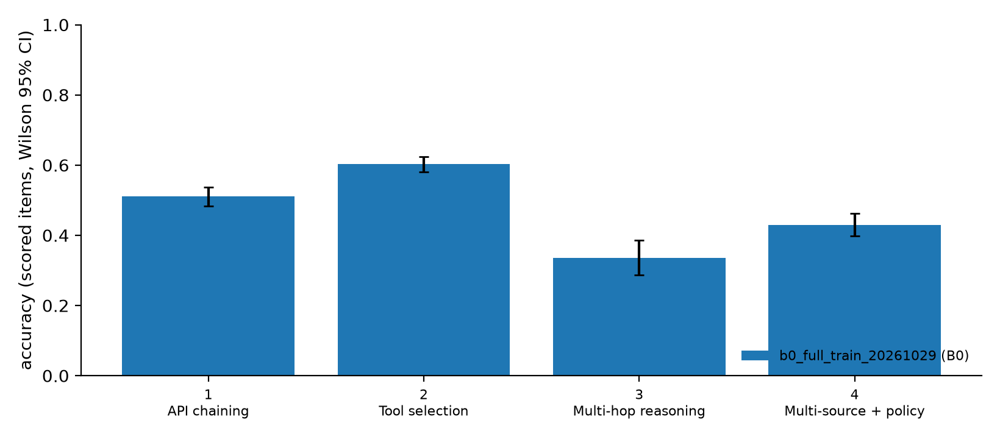
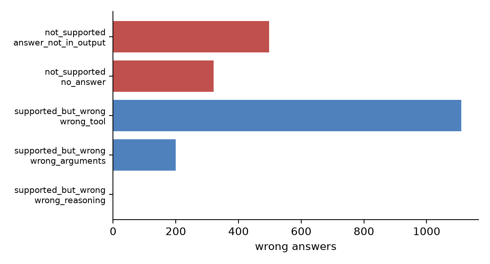

# VAKRA run summary

## b0_full_train_20261029

- variant: B0 · model: gpt-oss-120b · commit: 4e486587c3b8b1704ba7c70194eeeac63631157b · N/domain: None · spans: no

## Accuracy by capability (scored items only)

Correct = score ≥ 1.0. Excluded reference-wrong uuids: 0.

| run | variant | capability | scored/items | excluded | correct | accuracy | 95% CI | mean score | coverage |
|---|---|---|---|---|---|---|---|---|---|
| b0_full_train_20261029 | B0 | 1 · API chaining | 1324/1324 | 0 | 676 | 0.511 | [0.48, 0.54] | 0.511 | 1.000 |
| b0_full_train_20261029 | B0 | 2 · Tool selection | 1860/1860 | 0 | 1121 | 0.603 | [0.58, 0.62] | 0.603 | 1.000 |
| b0_full_train_20261029 | B0 | 3 · Multi-hop reasoning | 346/346 | 0 | 116 | 0.335 | [0.29, 0.39] | 0.335 | 1.000 |
| b0_full_train_20261029 | B0 | 4 · Multi-source + policy | 898/898 | 0 | 386 | 0.430 | [0.40, 0.46] | 0.430 | 1.000 |
| b0_full_train_20261029 | B0 | all | 4428/4428 | 0 | 2299 | 0.519 | [0.50, 0.53] | 0.519 | 1.000 |

## Latency and tokens

| run | capability | n | latency mean s | p50 | p90 | max | tokens/item | LLM calls/item | tool calls/item | est. cost $ |
|---|---|---|---|---|---|---|---|---|---|---|
| b0_full_train_20261029 | 1 · API chaining | 1324 | 82.881 | 41.495 | 287.633 | 574.044 |  |  | 3.327 |  |
| b0_full_train_20261029 | 2 · Tool selection | 1860 | 17.077 | 5.664 | 31.023 | 301.808 |  |  | 1.411 |  |
| b0_full_train_20261029 | 3 · Multi-hop reasoning | 346 | 70.885 | 43.306 | 164.237 | 300.004 |  |  | 2.610 |  |
| b0_full_train_20261029 | 4 · Multi-source + policy | 898 | 53.674 | 16.397 | 172.377 | 300.007 |  |  | 1.653 |  |
| b0_full_train_20261029 | all | 4428 | 48.379 | 16.286 | 143.691 | 574.044 |  |  | 2.126 |  |

Tokens come from tracing spans (`$RUN/traces`); blank when the run was not traced.

## Error labels (auto first pass; human labels override)

| run | headline | sub-reason | n | share |
|---|---|---|---|---|
| b0_full_train_20261029 | not_supported | answer_not_in_output | 498 | 0.234 |
| b0_full_train_20261029 | not_supported | no_answer | 320 | 0.150 |
| b0_full_train_20261029 | supported_but_wrong | wrong_tool | 1110 | 0.521 |
| b0_full_train_20261029 | supported_but_wrong | wrong_arguments | 200 | 0.094 |
| b0_full_train_20261029 | supported_but_wrong | wrong_reasoning | 1 | 0.000 |

Label the rows in `error_labels.csv` (human_headline / human_subreason / human_notes), then re-run with `--labels error_labels.csv`.

## Accuracy by domain

| run | variant | capability | domain | scored/items | excluded | correct | accuracy | 95% CI | mean score | coverage |
|---|---|---|---|---|---|---|---|---|---|---|
| b0_full_train_20261029 | B0 | 1 · API chaining | address | 66/66 | 0 | 26 | 0.394 | [0.29, 0.51] | 0.394 | 1.000 |
| b0_full_train_20261029 | B0 | 1 · API chaining | airline | 22/22 | 0 | 11 | 0.500 | [0.31, 0.69] | 0.500 | 1.000 |
| b0_full_train_20261029 | B0 | 1 · API chaining | authors | 54/54 | 0 | 3 | 0.056 | [0.02, 0.15] | 0.056 | 1.000 |
| b0_full_train_20261029 | B0 | 1 · API chaining | beer_factory | 29/29 | 0 | 17 | 0.586 | [0.41, 0.74] | 0.586 | 1.000 |
| b0_full_train_20261029 | B0 | 1 · API chaining | bike_share_1 | 17/17 | 0 | 8 | 0.471 | [0.26, 0.69] | 0.471 | 1.000 |
| b0_full_train_20261029 | B0 | 1 · API chaining | book_publishing_company | 26/26 | 0 | 15 | 0.577 | [0.39, 0.74] | 0.577 | 1.000 |
| b0_full_train_20261029 | B0 | 1 · API chaining | books | 89/89 | 0 | 55 | 0.618 | [0.51, 0.71] | 0.618 | 1.000 |
| b0_full_train_20261029 | B0 | 1 · API chaining | cars | 46/46 | 0 | 30 | 0.652 | [0.51, 0.77] | 0.652 | 1.000 |
| b0_full_train_20261029 | B0 | 1 · API chaining | codebase_comments | 38/38 | 0 | 25 | 0.658 | [0.50, 0.79] | 0.658 | 1.000 |
| b0_full_train_20261029 | B0 | 1 · API chaining | coinmarketcap | 18/18 | 0 | 6 | 0.333 | [0.16, 0.56] | 0.333 | 1.000 |
| b0_full_train_20261029 | B0 | 1 · API chaining | college_completion | 9/9 | 0 | 0 | 0.000 | [0.00, 0.30] | 0.000 | 1.000 |
| b0_full_train_20261029 | B0 | 1 · API chaining | computer_student | 27/27 | 0 | 5 | 0.185 | [0.08, 0.37] | 0.185 | 1.000 |
| b0_full_train_20261029 | B0 | 1 · API chaining | cookbook | 32/32 | 0 | 13 | 0.406 | [0.26, 0.58] | 0.406 | 1.000 |
| b0_full_train_20261029 | B0 | 1 · API chaining | disney | 23/23 | 0 | 16 | 0.696 | [0.49, 0.84] | 0.696 | 1.000 |
| b0_full_train_20261029 | B0 | 1 · API chaining | european_football_1 | 20/20 | 0 | 8 | 0.400 | [0.22, 0.61] | 0.400 | 1.000 |
| b0_full_train_20261029 | B0 | 1 · API chaining | food_inspection | 42/42 | 0 | 19 | 0.452 | [0.31, 0.60] | 0.452 | 1.000 |
| b0_full_train_20261029 | B0 | 1 · API chaining | genes | 10/10 | 0 | 2 | 0.200 | [0.06, 0.51] | 0.200 | 1.000 |
| b0_full_train_20261029 | B0 | 1 · API chaining | hockey | 1/1 | 0 | 0 | 0.000 | [0.00, 0.79] | 0.000 | 1.000 |
| b0_full_train_20261029 | B0 | 1 · API chaining | ice_hockey_draft | 48/48 | 0 | 25 | 0.521 | [0.38, 0.66] | 0.521 | 1.000 |
| b0_full_train_20261029 | B0 | 1 · API chaining | law_episode | 63/63 | 0 | 28 | 0.444 | [0.33, 0.57] | 0.444 | 1.000 |
| b0_full_train_20261029 | B0 | 1 · API chaining | menu | 25/25 | 0 | 11 | 0.440 | [0.27, 0.63] | 0.440 | 1.000 |
| b0_full_train_20261029 | B0 | 1 · API chaining | mondial_geo | 111/111 | 0 | 64 | 0.577 | [0.48, 0.66] | 0.577 | 1.000 |
| b0_full_train_20261029 | B0 | 1 · API chaining | music_tracker | 18/18 | 0 | 12 | 0.667 | [0.44, 0.84] | 0.667 | 1.000 |
| b0_full_train_20261029 | B0 | 1 · API chaining | olympics | 65/65 | 0 | 48 | 0.738 | [0.62, 0.83] | 0.738 | 1.000 |
| b0_full_train_20261029 | B0 | 1 · API chaining | professional_basketball | 41/41 | 0 | 12 | 0.293 | [0.18, 0.44] | 0.293 | 1.000 |
| b0_full_train_20261029 | B0 | 1 · API chaining | restaurant | 37/37 | 0 | 18 | 0.486 | [0.33, 0.64] | 0.486 | 1.000 |
| b0_full_train_20261029 | B0 | 1 · API chaining | shakespeare | 52/52 | 0 | 22 | 0.423 | [0.30, 0.56] | 0.423 | 1.000 |
| b0_full_train_20261029 | B0 | 1 · API chaining | soccer_2016 | 77/77 | 0 | 50 | 0.649 | [0.54, 0.75] | 0.649 | 1.000 |
| b0_full_train_20261029 | B0 | 1 · API chaining | talkingdata | 59/59 | 0 | 39 | 0.661 | [0.53, 0.77] | 0.661 | 1.000 |
| b0_full_train_20261029 | B0 | 1 · API chaining | trains | 9/9 | 0 | 6 | 0.667 | [0.35, 0.88] | 0.667 | 1.000 |
| b0_full_train_20261029 | B0 | 1 · API chaining | university | 66/66 | 0 | 42 | 0.636 | [0.52, 0.74] | 0.636 | 1.000 |
| b0_full_train_20261029 | B0 | 1 · API chaining | world | 52/52 | 0 | 29 | 0.558 | [0.42, 0.68] | 0.558 | 1.000 |
| b0_full_train_20261029 | B0 | 1 · API chaining | world_development_indicators | 32/32 | 0 | 11 | 0.344 | [0.20, 0.52] | 0.344 | 1.000 |
| b0_full_train_20261029 | B0 | 2 · Tool selection | address | 43/43 | 0 | 25 | 0.581 | [0.43, 0.72] | 0.581 | 1.000 |
| b0_full_train_20261029 | B0 | 2 · Tool selection | airline | 18/18 | 0 | 11 | 0.611 | [0.39, 0.80] | 0.611 | 1.000 |
| b0_full_train_20261029 | B0 | 2 · Tool selection | app_store | 14/14 | 0 | 8 | 0.571 | [0.33, 0.79] | 0.571 | 1.000 |
| b0_full_train_20261029 | B0 | 2 · Tool selection | authors | 68/68 | 0 | 46 | 0.676 | [0.56, 0.78] | 0.676 | 1.000 |
| b0_full_train_20261029 | B0 | 2 · Tool selection | beer_factory | 36/36 | 0 | 26 | 0.722 | [0.56, 0.84] | 0.722 | 1.000 |
| b0_full_train_20261029 | B0 | 2 · Tool selection | bike_share_1 | 37/37 | 0 | 14 | 0.378 | [0.24, 0.54] | 0.378 | 1.000 |
| b0_full_train_20261029 | B0 | 2 · Tool selection | book_publishing_company | 22/22 | 0 | 12 | 0.545 | [0.35, 0.73] | 0.545 | 1.000 |
| b0_full_train_20261029 | B0 | 2 · Tool selection | books | 78/78 | 0 | 60 | 0.769 | [0.66, 0.85] | 0.769 | 1.000 |
| b0_full_train_20261029 | B0 | 2 · Tool selection | cars | 40/40 | 0 | 29 | 0.725 | [0.57, 0.84] | 0.725 | 1.000 |
| b0_full_train_20261029 | B0 | 2 · Tool selection | citeseer | 2/2 | 0 | 1 | 0.500 | [0.09, 0.91] | 0.500 | 1.000 |
| b0_full_train_20261029 | B0 | 2 · Tool selection | codebase_comments | 73/73 | 0 | 47 | 0.644 | [0.53, 0.74] | 0.644 | 1.000 |
| b0_full_train_20261029 | B0 | 2 · Tool selection | coinmarketcap | 10/10 | 0 | 6 | 0.600 | [0.31, 0.83] | 0.600 | 1.000 |
| b0_full_train_20261029 | B0 | 2 · Tool selection | college_completion | 17/17 | 0 | 1 | 0.059 | [0.01, 0.27] | 0.059 | 1.000 |
| b0_full_train_20261029 | B0 | 2 · Tool selection | computer_student | 28/28 | 0 | 22 | 0.786 | [0.60, 0.90] | 0.786 | 1.000 |
| b0_full_train_20261029 | B0 | 2 · Tool selection | cookbook | 37/37 | 0 | 19 | 0.514 | [0.36, 0.67] | 0.514 | 1.000 |
| b0_full_train_20261029 | B0 | 2 · Tool selection | disney | 31/31 | 0 | 16 | 0.516 | [0.35, 0.68] | 0.516 | 1.000 |
| b0_full_train_20261029 | B0 | 2 · Tool selection | european_football_1 | 24/24 | 0 | 14 | 0.583 | [0.39, 0.76] | 0.583 | 1.000 |
| b0_full_train_20261029 | B0 | 2 · Tool selection | food_inspection | 23/23 | 0 | 15 | 0.652 | [0.45, 0.81] | 0.652 | 1.000 |
| b0_full_train_20261029 | B0 | 2 · Tool selection | genes | 14/14 | 0 | 6 | 0.429 | [0.21, 0.67] | 0.429 | 1.000 |
| b0_full_train_20261029 | B0 | 2 · Tool selection | hockey | 90/90 | 0 | 53 | 0.589 | [0.49, 0.68] | 0.589 | 1.000 |
| b0_full_train_20261029 | B0 | 2 · Tool selection | ice_hockey_draft | 46/46 | 0 | 38 | 0.826 | [0.69, 0.91] | 0.826 | 1.000 |
| b0_full_train_20261029 | B0 | 2 · Tool selection | image_and_language | 50/50 | 0 | 34 | 0.680 | [0.54, 0.79] | 0.680 | 1.000 |
| b0_full_train_20261029 | B0 | 2 · Tool selection | law_episode | 47/47 | 0 | 27 | 0.574 | [0.43, 0.70] | 0.574 | 1.000 |
| b0_full_train_20261029 | B0 | 2 · Tool selection | mental_health_survey | 27/27 | 0 | 10 | 0.370 | [0.22, 0.56] | 0.370 | 1.000 |
| b0_full_train_20261029 | B0 | 2 · Tool selection | menu | 58/58 | 0 | 37 | 0.638 | [0.51, 0.75] | 0.638 | 1.000 |
| b0_full_train_20261029 | B0 | 2 · Tool selection | mondial_geo | 107/107 | 0 | 71 | 0.664 | [0.57, 0.75] | 0.664 | 1.000 |
| b0_full_train_20261029 | B0 | 2 · Tool selection | movie_platform | 150/150 | 0 | 89 | 0.593 | [0.51, 0.67] | 0.593 | 1.000 |
| b0_full_train_20261029 | B0 | 2 · Tool selection | music_tracker | 19/19 | 0 | 11 | 0.579 | [0.36, 0.77] | 0.579 | 1.000 |
| b0_full_train_20261029 | B0 | 2 · Tool selection | olympics | 53/53 | 0 | 37 | 0.698 | [0.56, 0.80] | 0.698 | 1.000 |
| b0_full_train_20261029 | B0 | 2 · Tool selection | professional_basketball | 78/78 | 0 | 38 | 0.487 | [0.38, 0.60] | 0.487 | 1.000 |
| b0_full_train_20261029 | B0 | 2 · Tool selection | restaurant | 27/27 | 0 | 8 | 0.296 | [0.16, 0.48] | 0.296 | 1.000 |
| b0_full_train_20261029 | B0 | 2 · Tool selection | sales_in_weather | 54/54 | 0 | 18 | 0.333 | [0.22, 0.47] | 0.333 | 1.000 |
| b0_full_train_20261029 | B0 | 2 · Tool selection | shakespeare | 35/35 | 0 | 25 | 0.714 | [0.55, 0.84] | 0.714 | 1.000 |
| b0_full_train_20261029 | B0 | 2 · Tool selection | soccer_2016 | 83/83 | 0 | 56 | 0.675 | [0.57, 0.77] | 0.675 | 1.000 |
| b0_full_train_20261029 | B0 | 2 · Tool selection | student_loan | 88/88 | 0 | 40 | 0.455 | [0.35, 0.56] | 0.455 | 1.000 |
| b0_full_train_20261029 | B0 | 2 · Tool selection | talkingdata | 97/97 | 0 | 58 | 0.598 | [0.50, 0.69] | 0.598 | 1.000 |
| b0_full_train_20261029 | B0 | 2 · Tool selection | trains | 5/5 | 0 | 3 | 0.600 | [0.23, 0.88] | 0.600 | 1.000 |
| b0_full_train_20261029 | B0 | 2 · Tool selection | university | 61/61 | 0 | 46 | 0.754 | [0.63, 0.84] | 0.754 | 1.000 |
| b0_full_train_20261029 | B0 | 2 · Tool selection | world | 43/43 | 0 | 31 | 0.721 | [0.57, 0.83] | 0.721 | 1.000 |
| b0_full_train_20261029 | B0 | 2 · Tool selection | world_development_indicators | 27/27 | 0 | 13 | 0.481 | [0.31, 0.66] | 0.481 | 1.000 |
| b0_full_train_20261029 | B0 | 3 · Multi-hop reasoning | authors | 1/1 | 0 | 0 | 0.000 | [0.00, 0.79] | 0.000 | 1.000 |
| b0_full_train_20261029 | B0 | 3 · Multi-hop reasoning | beer_factory | 28/28 | 0 | 10 | 0.357 | [0.21, 0.54] | 0.357 | 1.000 |
| b0_full_train_20261029 | B0 | 3 · Multi-hop reasoning | bike_share_1 | 2/2 | 0 | 0 | 0.000 | [0.00, 0.66] | 0.000 | 1.000 |
| b0_full_train_20261029 | B0 | 3 · Multi-hop reasoning | book_publishing_company | 8/8 | 0 | 4 | 0.500 | [0.22, 0.78] | 0.500 | 1.000 |
| b0_full_train_20261029 | B0 | 3 · Multi-hop reasoning | books | 12/12 | 0 | 5 | 0.417 | [0.19, 0.68] | 0.417 | 1.000 |
| b0_full_train_20261029 | B0 | 3 · Multi-hop reasoning | cars | 7/7 | 0 | 2 | 0.286 | [0.08, 0.64] | 0.286 | 1.000 |
| b0_full_train_20261029 | B0 | 3 · Multi-hop reasoning | citeseer | 2/2 | 0 | 1 | 0.500 | [0.09, 0.91] | 0.500 | 1.000 |
| b0_full_train_20261029 | B0 | 3 · Multi-hop reasoning | codebase_comments | 1/1 | 0 | 0 | 0.000 | [0.00, 0.79] | 0.000 | 1.000 |
| b0_full_train_20261029 | B0 | 3 · Multi-hop reasoning | coinmarketcap | 6/6 | 0 | 0 | 0.000 | [0.00, 0.39] | 0.000 | 1.000 |
| b0_full_train_20261029 | B0 | 3 · Multi-hop reasoning | college_completion | 22/22 | 0 | 1 | 0.045 | [0.01, 0.22] | 0.045 | 1.000 |
| b0_full_train_20261029 | B0 | 3 · Multi-hop reasoning | computer_student | 20/20 | 0 | 2 | 0.100 | [0.03, 0.30] | 0.100 | 1.000 |
| b0_full_train_20261029 | B0 | 3 · Multi-hop reasoning | disney | 31/31 | 0 | 15 | 0.484 | [0.32, 0.65] | 0.484 | 1.000 |
| b0_full_train_20261029 | B0 | 3 · Multi-hop reasoning | european_football_1 | 11/11 | 0 | 5 | 0.455 | [0.21, 0.72] | 0.455 | 1.000 |
| b0_full_train_20261029 | B0 | 3 · Multi-hop reasoning | genes | 1/1 | 0 | 0 | 0.000 | [0.00, 0.79] | 0.000 | 1.000 |
| b0_full_train_20261029 | B0 | 3 · Multi-hop reasoning | hockey | 6/6 | 0 | 0 | 0.000 | [0.00, 0.39] | 0.000 | 1.000 |
| b0_full_train_20261029 | B0 | 3 · Multi-hop reasoning | ice_hockey_draft | 3/3 | 0 | 2 | 0.667 | [0.21, 0.94] | 0.667 | 1.000 |
| b0_full_train_20261029 | B0 | 3 · Multi-hop reasoning | image_and_language | 9/9 | 0 | 1 | 0.111 | [0.02, 0.44] | 0.111 | 1.000 |
| b0_full_train_20261029 | B0 | 3 · Multi-hop reasoning | law_episode | 6/6 | 0 | 2 | 0.333 | [0.10, 0.70] | 0.333 | 1.000 |
| b0_full_train_20261029 | B0 | 3 · Multi-hop reasoning | mondial_geo | 22/22 | 0 | 8 | 0.364 | [0.20, 0.57] | 0.364 | 1.000 |
| b0_full_train_20261029 | B0 | 3 · Multi-hop reasoning | music_tracker | 3/3 | 0 | 0 | 0.000 | [0.00, 0.56] | 0.000 | 1.000 |
| b0_full_train_20261029 | B0 | 3 · Multi-hop reasoning | olympics | 7/7 | 0 | 6 | 0.857 | [0.49, 0.97] | 0.857 | 1.000 |
| b0_full_train_20261029 | B0 | 3 · Multi-hop reasoning | restaurant | 6/6 | 0 | 0 | 0.000 | [0.00, 0.39] | 0.000 | 1.000 |
| b0_full_train_20261029 | B0 | 3 · Multi-hop reasoning | soccer_2016 | 78/78 | 0 | 38 | 0.487 | [0.38, 0.60] | 0.487 | 1.000 |
| b0_full_train_20261029 | B0 | 3 · Multi-hop reasoning | student_loan | 1/1 | 0 | 0 | 0.000 | [0.00, 0.79] | 0.000 | 1.000 |
| b0_full_train_20261029 | B0 | 3 · Multi-hop reasoning | trains | 13/13 | 0 | 1 | 0.077 | [0.01, 0.33] | 0.077 | 1.000 |
| b0_full_train_20261029 | B0 | 3 · Multi-hop reasoning | university | 15/15 | 0 | 5 | 0.333 | [0.15, 0.58] | 0.333 | 1.000 |
| b0_full_train_20261029 | B0 | 3 · Multi-hop reasoning | world | 6/6 | 0 | 5 | 0.833 | [0.44, 0.97] | 0.833 | 1.000 |
| b0_full_train_20261029 | B0 | 3 · Multi-hop reasoning | world_development_indicators | 19/19 | 0 | 3 | 0.158 | [0.06, 0.38] | 0.158 | 1.000 |
| b0_full_train_20261029 | B0 | 4 · Multi-source + policy | address | 70/70 | 0 | 16 | 0.229 | [0.15, 0.34] | 0.229 | 1.000 |
| b0_full_train_20261029 | B0 | 4 · Multi-source + policy | airline | 51/51 | 0 | 18 | 0.353 | [0.24, 0.49] | 0.353 | 1.000 |
| b0_full_train_20261029 | B0 | 4 · Multi-source + policy | app_store | 30/30 | 0 | 15 | 0.500 | [0.33, 0.67] | 0.500 | 1.000 |
| b0_full_train_20261029 | B0 | 4 · Multi-source + policy | authors | 21/21 | 0 | 0 | 0.000 | [0.00, 0.15] | 0.000 | 1.000 |
| b0_full_train_20261029 | B0 | 4 · Multi-source + policy | beer_factory | 29/29 | 0 | 21 | 0.724 | [0.54, 0.85] | 0.724 | 1.000 |
| b0_full_train_20261029 | B0 | 4 · Multi-source + policy | bike_share_1 | 36/36 | 0 | 23 | 0.639 | [0.48, 0.78] | 0.639 | 1.000 |
| b0_full_train_20261029 | B0 | 4 · Multi-source + policy | book_publishing_company | 12/12 | 0 | 7 | 0.583 | [0.32, 0.81] | 0.583 | 1.000 |
| b0_full_train_20261029 | B0 | 4 · Multi-source + policy | books | 28/28 | 0 | 20 | 0.714 | [0.53, 0.85] | 0.714 | 1.000 |
| b0_full_train_20261029 | B0 | 4 · Multi-source + policy | cars | 20/20 | 0 | 12 | 0.600 | [0.39, 0.78] | 0.600 | 1.000 |
| b0_full_train_20261029 | B0 | 4 · Multi-source + policy | codebase_comments | 5/5 | 0 | 2 | 0.400 | [0.12, 0.77] | 0.400 | 1.000 |
| b0_full_train_20261029 | B0 | 4 · Multi-source + policy | coinmarketcap | 22/22 | 0 | 12 | 0.545 | [0.35, 0.73] | 0.545 | 1.000 |
| b0_full_train_20261029 | B0 | 4 · Multi-source + policy | college_completion | 1/1 | 0 | 0 | 0.000 | [0.00, 0.79] | 0.000 | 1.000 |
| b0_full_train_20261029 | B0 | 4 · Multi-source + policy | computer_student | 20/20 | 0 | 1 | 0.050 | [0.01, 0.24] | 0.050 | 1.000 |
| b0_full_train_20261029 | B0 | 4 · Multi-source + policy | cookbook | 15/15 | 0 | 7 | 0.467 | [0.25, 0.70] | 0.467 | 1.000 |
| b0_full_train_20261029 | B0 | 4 · Multi-source + policy | disney | 6/6 | 0 | 3 | 0.500 | [0.19, 0.81] | 0.500 | 1.000 |
| b0_full_train_20261029 | B0 | 4 · Multi-source + policy | european_football_1 | 3/3 | 0 | 1 | 0.333 | [0.06, 0.79] | 0.333 | 1.000 |
| b0_full_train_20261029 | B0 | 4 · Multi-source + policy | food_inspection | 42/42 | 0 | 18 | 0.429 | [0.29, 0.58] | 0.429 | 1.000 |
| b0_full_train_20261029 | B0 | 4 · Multi-source + policy | genes | 3/3 | 0 | 1 | 0.333 | [0.06, 0.79] | 0.333 | 1.000 |
| b0_full_train_20261029 | B0 | 4 · Multi-source + policy | hockey | 71/71 | 0 | 21 | 0.296 | [0.20, 0.41] | 0.296 | 1.000 |
| b0_full_train_20261029 | B0 | 4 · Multi-source + policy | ice_hockey_draft | 13/13 | 0 | 12 | 0.923 | [0.67, 0.99] | 0.923 | 1.000 |
| b0_full_train_20261029 | B0 | 4 · Multi-source + policy | image_and_language | 18/18 | 0 | 10 | 0.556 | [0.34, 0.75] | 0.556 | 1.000 |
| b0_full_train_20261029 | B0 | 4 · Multi-source + policy | law_episode | 22/22 | 0 | 8 | 0.364 | [0.20, 0.57] | 0.364 | 1.000 |
| b0_full_train_20261029 | B0 | 4 · Multi-source + policy | menu | 18/18 | 0 | 1 | 0.056 | [0.01, 0.26] | 0.056 | 1.000 |
| b0_full_train_20261029 | B0 | 4 · Multi-source + policy | mondial_geo | 47/47 | 0 | 25 | 0.532 | [0.39, 0.67] | 0.532 | 1.000 |
| b0_full_train_20261029 | B0 | 4 · Multi-source + policy | music_tracker | 6/6 | 0 | 5 | 0.833 | [0.44, 0.97] | 0.833 | 1.000 |
| b0_full_train_20261029 | B0 | 4 · Multi-source + policy | olympics | 46/46 | 0 | 10 | 0.217 | [0.12, 0.36] | 0.217 | 1.000 |
| b0_full_train_20261029 | B0 | 4 · Multi-source + policy | professional_basketball | 36/36 | 0 | 12 | 0.333 | [0.20, 0.50] | 0.333 | 1.000 |
| b0_full_train_20261029 | B0 | 4 · Multi-source + policy | restaurant | 26/26 | 0 | 6 | 0.231 | [0.11, 0.42] | 0.231 | 1.000 |
| b0_full_train_20261029 | B0 | 4 · Multi-source + policy | sales_in_weather | 16/16 | 0 | 10 | 0.625 | [0.39, 0.82] | 0.625 | 1.000 |
| b0_full_train_20261029 | B0 | 4 · Multi-source + policy | shakespeare | 37/37 | 0 | 21 | 0.568 | [0.41, 0.71] | 0.568 | 1.000 |
| b0_full_train_20261029 | B0 | 4 · Multi-source + policy | soccer_2016 | 15/15 | 0 | 10 | 0.667 | [0.42, 0.85] | 0.667 | 1.000 |
| b0_full_train_20261029 | B0 | 4 · Multi-source + policy | student_loan | 38/38 | 0 | 20 | 0.526 | [0.37, 0.68] | 0.526 | 1.000 |
| b0_full_train_20261029 | B0 | 4 · Multi-source + policy | talkingdata | 29/29 | 0 | 17 | 0.586 | [0.41, 0.74] | 0.586 | 1.000 |
| b0_full_train_20261029 | B0 | 4 · Multi-source + policy | university | 17/17 | 0 | 9 | 0.529 | [0.31, 0.74] | 0.529 | 1.000 |
| b0_full_train_20261029 | B0 | 4 · Multi-source + policy | world | 23/23 | 0 | 10 | 0.435 | [0.26, 0.63] | 0.435 | 1.000 |
| b0_full_train_20261029 | B0 | 4 · Multi-source + policy | world_development_indicators | 6/6 | 0 | 2 | 0.333 | [0.10, 0.70] | 0.333 | 1.000 |
